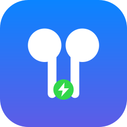
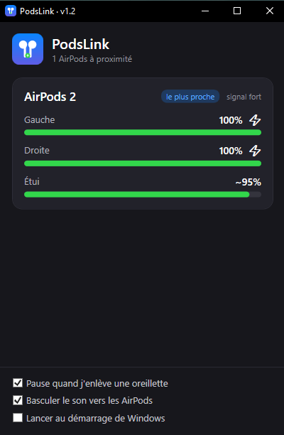

<p align="center"></p>

<h1 align="center">PodsLink</h1>
<p align="center">Une petite app de zone de notification qui apporte aux AirPods une expérience façon MagicPods sur Windows.<br>
<a href="README.md">🇬🇧 English version</a></p>

<p align="center"></p>

## Fonctionnalités
- 🔋 **Batterie** de l'oreillette gauche, droite et de l'étui, avec charge et détection « dans l'oreille »
- 🪟 **Popup** à l'ouverture de l'étui et fenêtre listant tous les AirPods à proximité
- ⏯️ **Pause / reprise automatique** quand tu retires / remets une oreillette
- 🔊 **Le son te suit** : les AirPods deviennent la sortie par défaut quand tu les portes, l'ancienne sortie est restaurée au retrait
- 🚀 **Démarrage avec Windows** en option, icône unique affichant la batterie la plus faible
- 🌍 Interface **English / Français** (suit la langue de Windows, modifiable depuis le menu)
- 🔒 **100 % local** : aucun accès réseau, aucune télémétrie, rien d'écrit sur le disque

## Prérequis
- Windows 10 (19041+) ou Windows 11, adaptateur Bluetooth LE
- AirPods appairés **et connectés** à Windows (pour le routage audio ; la batterie s'affiche dès l'ouverture de l'étui à proximité)
- Pour compiler : [SDK .NET 8](https://dotnet.microsoft.com/download)

## Installation
Télécharge `PodsLink.exe` dans les [Releases](../../releases), place-le dans un **dossier permanent**
(ex. `%LOCALAPPDATA%\PodsLink`), lance-le, puis coche *Lancer au démarrage de Windows* si tu veux.
Deux variantes : *autonome* (~150 Mo) ou *légère* (quelques Mo, nécessite le
[.NET 8 Desktop Runtime](https://dotnet.microsoft.com/download/dotnet/8.0)).

## Compiler
```powershell
git clone https://github.com/snaks12/PodsLink.git
cd PodsLink
dotnet run -c Release      # lancer
publish.bat                # générer les .exe dans dist\
```

## Utilisation
Clic gauche sur l'icône : fenêtre des AirPods. Clic droit : réglages et quitter. Ouvre l'étui près du PC : la popup apparaît.

## Fonctionnement
Les AirPods émettent des messages Apple « Proximity Pairing » en Bluetooth LE (identifiant `0x004C`, type `0x07`).
PodsLink les écoute avec `BluetoothLEAdvertisementWatcher`. La pause utilise les contrôles média de Windows, et le
changement de sortie l'interface COM non documentée `IPolicyConfig`. Le format a été décrypté par la communauté
(voir [OpenPods](https://github.com/adolfintel/OpenPods), [AirStatus](https://github.com/delphiki/AirStatus),
[furiousMAC/continuity](https://github.com/furiousMAC/continuity)).

## Limites connues
- **La batterie est une estimation** : les paquets n'ont que des paliers de 10 %, donc PodsLink affiche le milieu du palier (`~85 %` pour 80–89 %).
- Les AirPods changent d'adresse à chaque ouverture de l'étui : les doublons sont fusionnés par heuristique. Deux paires du même modèle aux batteries proches peuvent être confondues.
- Pas de réduction de bruit, audio spatial, firmware : protocole propriétaire d'Apple.
- Testé sur **AirPods 2** uniquement. Les autres modèles sont reconnus d'après la documentation communautaire mais non testés.
- Le routage audio repère la sortie dont le nom contient « AirPods » : ne les renomme pas dans Windows.

## Sécurité et vie privée
Pas de réseau, pas de journal, aucun fichier écrit. Voir [SECURITY.md](SECURITY.md).

## Licence et avertissement
[MIT](LICENSE). Projet indépendant, **non affilié à Apple Inc.** AirPods est une marque d'Apple Inc. Non affilié à MagicPods.
