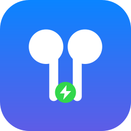
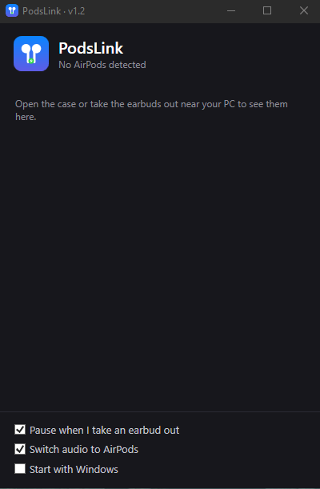

<p align="center"></p>

<h1 align="center">PodsLink</h1>
<p align="center">A lightweight tray app that gives AirPods a MagicPods-like experience on Windows.<br>
<a href="README.fr.md">🇫🇷 Version française</a></p>

<!-- Add a screenshot: docs/screenshot.png -->
<p align="center"></p>

## Features
- 🔋 **Battery levels** for left bud, right bud and case, with charging state and in-ear indicators
- 🪟 **Popup** when you open the case, plus a window listing every AirPods in range
- ⏯️ **Auto-pause / resume** when you take a bud out / put it back
- 🔊 **Audio follows you**: your AirPods become the default output when worn, the previous output is restored when removed
- 🚀 Optional **start with Windows**, single tray icon showing the lowest battery
- 🌍 **English / Français** interface (follows Windows language, switchable from the tray menu)
- 🔒 **100 % local**: no network access, no telemetry, nothing written to disk

## Requirements
- Windows 10 (19041+) or Windows 11
- A Bluetooth LE adapter
- AirPods paired **and connected** to Windows (needed for audio routing; battery display works as soon as the case is opened nearby)
- To build from source: [.NET 8 SDK](https://dotnet.microsoft.com/download)

## Install
Download `PodsLink.exe` from the [Releases](../../releases) page, put it in a **permanent folder**
(e.g. `%LOCALAPPDATA%\PodsLink`), run it, then tick *Start with Windows* if you want.
Two variants are provided: *standalone* (~150 MB, nothing to install) and *light* (a few MB, requires the
[.NET 8 Desktop Runtime](https://dotnet.microsoft.com/download/dotnet/8.0)).

## Build from source
```powershell
git clone https://github.com/snaks12/PodsLink.git
cd PodsLink
dotnet run -c Release          # run
publish.bat                    # build both .exe variants into dist\
```

## Usage
The app lives in the notification area (check the hidden icons arrow).
- **Left-click** the icon: open the AirPods window
- **Right-click**: settings (auto-pause, route audio, start with Windows) and quit
- Open the case near your PC: the popup shows up

## How it works
AirPods broadcast Apple "Proximity Pairing" messages over Bluetooth LE (company ID `0x004C`, type `0x07`).
PodsLink listens with Windows' `BluetoothLEAdvertisementWatcher` and decodes battery, charging and in-ear flags.
Pause/resume uses the system media controls (`GlobalSystemMediaTransportControls`); the default output is switched
through the unofficial `IPolicyConfig` COM interface.

The format is not officially documented. It was worked out by the community — see
[OpenPods](https://github.com/adolfintel/OpenPods), [AirStatus](https://github.com/delphiki/AirStatus) and the
[Apple Continuity reverse-engineering](https://github.com/furiousMAC/continuity) project.

## Known limitations
- **Battery is an estimate.** Broadcasts only carry 10 % steps, so PodsLink shows the middle of the step
  (`~85 %` for 80–89 %). Only a connected iPhone/Mac gets the exact value.
- AirPods rotate their Bluetooth address every time the case opens; PodsLink merges entries heuristically
  (model + similar battery + signal). Two same-model pairs with near-identical batteries in range may be merged.
- No noise-control switching, spatial audio, firmware info or renaming: these use Apple's proprietary protocol.
- Tested on **AirPods 2**. Other models (AirPods 1, 3, 4, Pro, Pro 2, Max) are recognised from community
  documentation but untested — reports and packet dumps are welcome.
- Audio routing matches the output whose name contains "AirPods"; don't rename them in Windows.

## Security & privacy
No network, no logging, no files written. See [SECURITY.md](SECURITY.md) for details and known limits
(BLE advertisements are unauthenticated and can be spoofed by someone nearby).

## Troubleshooting
| Problem | Fix |
|---|---|
| `NU1100` on first build | Add nuget.org: `dotnet nuget add source https://api.nuget.org/v3/index.json -n nuget.org` |
| Nothing detected | Check Bluetooth is on, open the case close to the PC (signal > -75 dBm) |
| `publish.bat` can't overwrite the exe | Quit PodsLink first (the script now does it for you) |
| Audio doesn't switch | AirPods must be connected to Windows as an audio device |

## Contributing
Issues and pull requests are welcome, especially for other AirPods / Beats models.

## License
[MIT](LICENSE)

## Disclaimer
PodsLink is an independent project, **not affiliated with, endorsed by or sponsored by Apple Inc.**
AirPods is a trademark of Apple Inc. It is not affiliated with MagicPods either; it was simply inspired by its idea.
